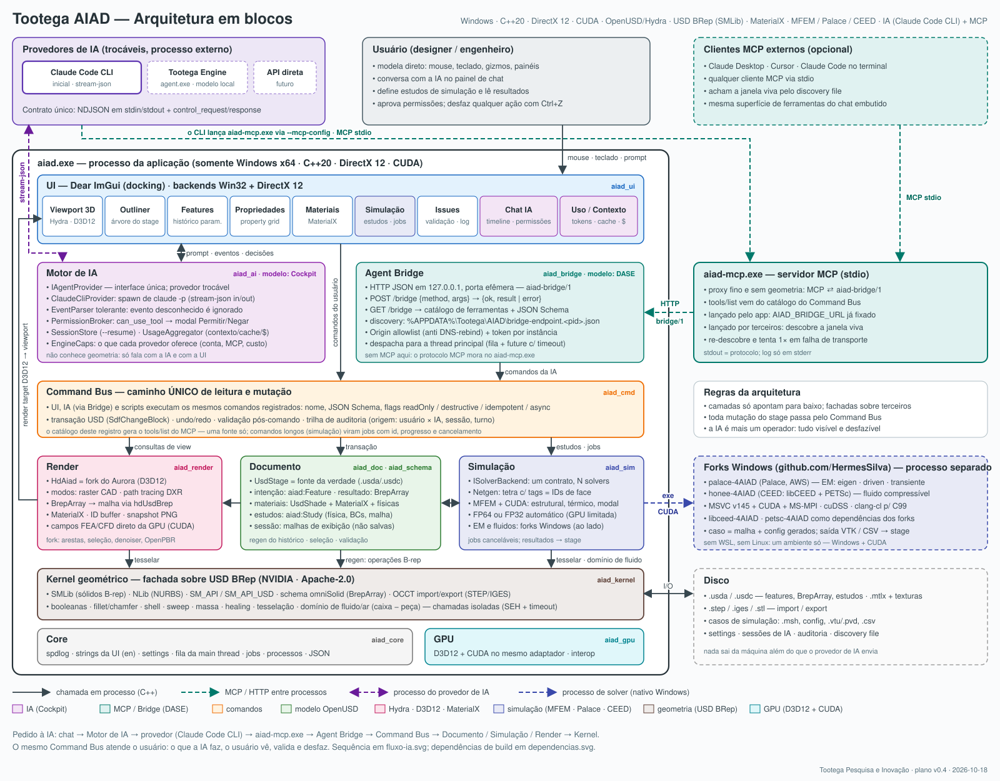

# 02 — Arquitetura

> Tootega AIAD · plano v0.4 · 2026-10-18 · **somente Windows x64 · DirectX 12 · CUDA**
> Diagramas: [arquitetura-blocos.svg](diagrams/arquitetura-blocos.svg) ·
> [dependencias.svg](diagrams/dependencias.svg) · [fluxo-ia.svg](diagrams/fluxo-ia.svg)



---

## 1. Princípios

1. **Um ambiente só:** Windows x64, DirectX 12 para gráficos e CUDA para cálculo. Nada de
   OpenGL, Vulkan, Linux ou WSL dentro do produto.
2. **OpenUSD é a fonte da verdade.** O documento **é** um `UsdStage`: geometria, materiais e
   estudos de simulação.
3. **Um caminho só para mudar o modelo:** o **Command Bus**. UI, IA e scripts usam os mesmos
   comandos, o mesmo undo, a mesma validação e a mesma trilha de auditoria.
4. **A IA não é especial.** Ela é mais um operador da ferramenta, com permissões, e tudo o que faz
   o usuário vê, valida e desfaz. (Herança do DASE.)
5. **O app não reimplementa o agente.** Loop, raciocínio, ferramentas e contexto ficam no provedor
   (inicialmente o Claude Code CLI). O app apresenta e controla. (Herança do Cockpit.)
6. **Trocável por contrato, não por `if`:** `IAgentProvider` + `EngineCaps` (IA);
   `ISolverBackend` + `SolverCaps` (física); `IVolumeMesher` (malha).
7. **Fachadas sobre terceiros:** só `aiad_kernel` inclui USD BRep; só `aiad_render`, `aiad_gpu` e
   `aiad_ui` incluem D3D12; só `aiad_sim` e `aiad_gpu` incluem CUDA; só `aiad_sim` inclui
   MFEM/libCEED; só `aiad_ui` inclui ImGui.
8. **Camadas só apontam para baixo** (verificado no CMake). GPL/AGPL só fora do processo; LGPL só
   por link dinâmico. Ver [dependencias.svg](diagrams/dependencias.svg).

---

## 2. Decisões registradas

| # | Decisão | Alternativa descartada | Motivo |
|---|---------|------------------------|--------|
| D1 | **Somente Windows x64**; C++20; **DirectX 12** + **CUDA** | multiplataforma | decisão do usuário: economizar com multi-ambiente |
| D2 | **MCP fora do app**: `aiad-mcp.exe` (stdio) ↔ `aiad_bridge` (HTTP loopback `aiad-bridge/1`) | MCP embutido no app | arquitetura v2 do DASE, já validada |
| D3 | `aiad-mcp.exe` em **C++**, proxy fino, dependendo só de `aiad_core` | servidor MCP em Node/TS | um toolchain e um instalador; o proxy é genérico |
| D4 | **Hydra (UsdImaging) + fork do Autodesk Aurora** (`HdAurora` → `HdAiad`): mantém o path tracing DXR e ganha um **modo raster CAD** (arestas, ID buffer, seleção, campos CUDA). O `BrepArray` chega ao delegate como malha pelo plugin **`hdUsdBrep`** do próprio USD BRep | Storm em OpenGL; HgiDX12; delegate D3D12 do zero | o OpenUSD não tem backend DirectX; o Aurora já é Hydra + D3D12 + MaterialX (Apache-2.0), mas é só path tracer, só triângulos e ainda sem denoiser |
| D5 | Documento em **camadas**: intenção (features), resultado (`BrepArray`), materiais, estudos, sessão | só `BrepArray` (modelagem direta) | a IA trabalha melhor editando **intenção paramétrica**; regen é determinístico e auditável |
| D6 | Catálogo de ferramentas **gerado** do registro de comandos | escrever ferramentas MCP à mão | elimina a duplicação que o DASE tem hoje |
| D7 | Toda mutação na **main thread**; bridge, IA e jobs conversam por fila | locks no stage | `UsdStage` não é seguro para escrita concorrente |
| D8 | Snapshot do viewport é ferramenta de primeira classe | IA "às cegas" | o laço *agir → ver → corrigir* é o diferencial de um AIAD |
| D9 | **Projeto open source.** A licença segue o que as dependências exigirem; hoje todas são Apache/BSD/MIT/MPL/LGPL, e a recomendação é **Apache-2.0** (a mesma de USD BRep, Aurora, Palace e MaterialX). **Idioma: só inglês** (internacional, neutro) no código, nos comentários, nos commits e na **UI** do software; sem camada de tradução | licença proprietária; UI bilíngue | decisão do usuário; uma dependência GPL linkada tornaria o produto GPL, o que é aceitável |
| D10 | **Simulação por `ISolverBackend`**: MFEM + CUDA **em processo**; **forks Windows** em github.com/HermesSilva (sufixo `-4AIAD`): `palace-4AIAD` (EM) e `honee-4AIAD` (CEED, escoamento compressível), com libCEED/PETSc e demais dependências convertidos para MSVC + CUDA | WSL/Linux; reescrever as formulações | decisão do usuário: fork e conversão para Windows |
| D11 | **Material único**: `UsdShadeMaterial` com rede **MaterialX/OpenPBR** (aparência) **+** `aiad:physics:*` (propriedades físicas) | catálogos separados | render e simulação leem a mesma fonte |
| D12 | Comandos longos são **assíncronos** (jobs com id, progresso e cancelamento) | bloquear a ferramenta MCP | simulações levam de minutos a horas |
| D13 | **`aiad_gpu`**: um adaptador para D3D12 e CUDA (casado por **LUID**); interop por memória externa + fences | contextos independentes | campos de simulação vão da CUDA para o viewport **sem cópia** |
| D14 | Shaders: o que o Aurora já faz para MaterialX (Standard Surface) no D3D12; OpenPBR e o modo raster entram no fork via **MaterialX → Slang → HLSL/DXIL** | GLSL | caminho do MaterialX para DirectX sem Storm |
| D15 | **Precisão automática:** FP64 quando a GPU tem FP64 cheio; **FP32 quando a placa é limitada** (detecção por `cudaDevAttrSingleToDoublePrecisionPerfRatio`). No MFEM a precisão é de compilação (`real_t`), então o backend sai em **duas DLLs** (`aiad_sim_fp64`, `aiad_sim_fp32`) carregadas em runtime | uma precisão só | decisão do usuário; a RTX 2060 SUPER (GeForce) é limitada em FP64 |
| D16 | **Mesher: Netgen** (LGPL-2.1, estático — D18 —, pela API C++): B-rep → `.brep` OCCT (via `OCCT_BREP_EXPORT`, que **não** linka o OCCT) → geometria OCC do Netgen → tetraedros (até 2ª ordem) com faces numeradas → atributos de contorno = IDs persistentes de face → `mfem::Mesh` em memória (ou `.vol`/`.msh` para os forks) | fTetWild, Gmsh | é o que o usuário pediu para avaliar e cobre o caso (OCC + STEP/IGES + STL, Windows, MFEM lê o formato Netgen) |
| D18 | **Tudo linkado estaticamente** num `aiad.exe` autocontido (mais os executáveis de solver). Exceções: componentes do SO (D3D12, DXGI, Win32), driver NVIDIA (`nvcuda.dll`), compilador de shaders em runtime (`dxcompiler.dll`/`dxil.dll`), runtime do MS-MPI nos solvers, o CRT da Microsoft (`/MD`) e cuSPARSE/cuBLAS (usados pelo MFEM; a NVIDIA não distribui versão estática no Windows — o runtime CUDA em si é estático). Consequências: OpenUSD 25.11 **compilado do fonte, estático, sem Python, sem GL/Vulkan**; plugins USD (`HdAurora`, `hdUsdBrep`, `omniSolid`, schema AIAD) linkados no executável com `/WHOLEARCHIVE`; **um único MaterialX** (1.39.5 com Slang); USD BRep recompilado contra esse USD | DLLs de terceiros; OpenUSD do Packman | decisão do usuário; elimina colisões de DLL (duas versões de MaterialX) e problemas de `dllimport` (nglib) |
| D17 | **USD BRep compilado com MSVC v145** (patch temporário em `repo.toml`: `vs18`) e binários guardados em `deps/usd-brep/` | toolset v142 | decisão do usuário; o OpenUSD 25.11 do Packman (compilado com v142) é ABI-compatível com v145 |

---

## 3. Módulos (alvos CMake)

| Alvo | Tipo | Responsabilidade | Depende de |
|------|------|------------------|-----------|
| `aiad_core` | lib | log, tabela de strings da UI (en), settings, fila da main thread, jobs, runner de processos Win32 (pipes, Job Objects), IDs, `Result<T>`, JSON | spdlog, nlohmann/json |
| `aiad_gpu` | lib | seleção de adaptador (DXGI ↔ CUDA por LUID), device/filas D3D12, contexto CUDA, recursos compartilhados, fences | core, D3D12, CUDA runtime |
| `aiad_kernel` | lib | fachada sobre USD BRep: primitivas, booleanas, fillet, shell, sweep, massa, heal, tesselação, **domínio de fluido/ar**, STEP; chamadas isoladas (SEH + timeout) | core, USD BRep |
| `aiad_schema` | plugin USD | `AiadFeature`, `AiadStudy`, `AiadBoundaryCondition`, `AiadPhysicsMaterialAPI` (usdGenSchema) | OpenUSD |
| `aiad_doc` | lib | stage e camadas, árvore de features, regenerador, materiais, estudos, seleção, validação | core, kernel, schema, OpenUSD (+ usdMtlx) |
| `aiad_cmd` | lib | registro de comandos, schemas, execução transacional, jobs, undo/redo, auditoria | core, doc |
| `aiad_render` | lib | integração do `HdAiad` (fork do Aurora: raster CAD + path tracing DXR), `hdUsdBrep` para `BrepArray`, picking por ID buffer, snapshot, campos de resultado | core, cmd, gpu, OpenUSD (UsdImaging, Hd, hdMtlx), Aurora (fork), D3D12, DXC, Slang |
| `aiad_sim` | lib | estudos, malha (`IVolumeMesher` → Netgen), `ISolverBackend` (MFEM fp64/fp32, Palace, HONEE), leitura de resultados | core, cmd, gpu, MFEM, libCEED, CUDA, Netgen + OCCT (estáticos) |
| `aiad_ai` | lib | `IAgentProvider`, `ClaudeCliProvider`, parser de eventos, sessões, uso, permissões | core (**não** conhece geometria) |
| `aiad_bridge` | lib | servidor HTTP loopback, discovery, segurança, despacho para a main thread | core, cmd, cpp-httplib |
| `aiad_ui` | lib | shell ImGui (Win32 + DX12), painéis, chat, modais, editor de materiais, painel de simulação | core, ai, bridge, render, sim, ImGui stack |
| `aiad` | exe | `wWinMain`, janela Win32, swapchain, loop de frames | ui |
| `aiad-mcp` | exe | proxy MCP stdio ↔ `aiad-bridge/1` | core, cpp-httplib (cliente) |
| `aiad_tests` | exe | testes unitários e de integração (inclui testes de GPU marcados) | todas, GoogleTest |

---

## 4. Modelo de documento

```
model.usda                         ← camada raiz (salva)
 ├─ intent.usda     (sublayer)     ← /Model/Features/*   AiadFeature (tipo, parâmetros, entradas)
 ├─ result.usda     (sublayer)     ← /Model/Bodies/*     omniSolid BrepArray (gerado pelo regen)
 ├─ materials.usda  (sublayer)     ← /Model/Materials/*  UsdShadeMaterial (MaterialX) + aiad:physics:*
 ├─ studies.usda    (sublayer)     ← /Model/Studies/*    AiadStudy, BCs, malha, ref. a resultados
 └─ [session layer, em memória]    ← malhas de exibição e campos de resultado (nunca salvos)
```

- **Feature** = operação parametrizada (`box`, `cylinder`, `extrude`, `revolve`, `boolean`,
  `fillet`, `chamfer`, `shell`, `pattern`, `transform`, `import`), com entradas por **SdfPath**.
- **Regen** percorre a árvore em ordem topológica, chama o kernel e grava os `BrepArray` em
  `result.usda`. Regen incremental.
- **Modelagem direta** continua possível: uma feature `import`/`frozen` guarda um `BrepArray` sem
  histórico.
- **Identidade:** prims por `SdfPath`; faces e arestas por **IDs persistentes** atribuídos no
  regen (*topological naming*). É crítico porque estudos referenciam faces (R12). Começar com IDs
  por linhagem de feature + hash geométrico e revisar na F5.
- **Material** (D11): `UsdShadeMaterial` com `outputs:mtlx:surface` (OpenPBR/standard_surface;
  texturas e `.mtlx` referenciados) + `AiadPhysicsMaterialAPI`: `density`, `youngModulus`,
  `poissonRatio`, `thermalConductivity`, `specificHeat`, `thermalExpansion`, `yieldStrength`,
  `relPermittivity`, `relPermeability`, `conductivity`, `lossTangent`, e para fluidos
  `gasConstant`, `gamma`, `viscosity`. Vínculo via `material:binding`.
- **Estudo** (`AiadStudy`): `physics` = `structural` | `thermal` | `modal` | `em.eigen` |
  `em.driven` | `em.transient` | `em.electrostatic` | `em.magnetostatic` | `fluid.compressible`;
  corpos/domínios, BCs (`AiadBoundaryCondition` → IDs de face), malha, backend, precisão
  (`fp64` | `fp32` | `mixed`), solver e referências aos resultados + resumo.
- **Unidades:** `metersPerUnit` do stage (padrão mm), convertido para SI na fronteira com os
  solvers.

---

## 5. Command Bus

```cpp
struct CommandSpec {
    std::string    name;          // "feature.create", "material.assign", "sim.run", "view.snapshot"
    std::string    title;         // UI string (English)
    nlohmann::json inputSchema;   // JSON Schema — vira o inputSchema da ferramenta MCP
    bool readOnly = false, destructive = false, idempotent = false, async = false;
};

struct CommandContext {
    Origin origin;                // User | Ai{sessionId, turn} | Script
    Document& doc;
    JobHandle* job = nullptr;     // presente quando async: progresso e cancelamento
};

class ICommand {
public:
    virtual ~ICommand() = default;
    virtual const CommandSpec& Spec() const = 0;
    virtual Result<nlohmann::json> Execute(CommandContext&, const nlohmann::json& args) = 0;
};
```

- Execução: valida `args` contra o schema → abre transação (`SdfChangeBlock` + undo) → executa →
  regen → valida → fecha → publica evento (UI, render, auditoria).
- `async`: o comando retorna `{jobId}` na hora; o trabalho pesado roda em thread de job, na GPU ou
  num `.exe` externo; a conclusão vira **outro comando** (`sim.apply_results`) executado na main
  thread, com undo próprio.
- Resultado: Markdown curto legível por LLM **e** JSON estruturado (+ imagens quando houver);
  erro = mensagem acionável, sem stack (padrão DASE).
- Os módulos registram os próprios comandos no startup (`aiad_render` registra `view.*`,
  `aiad_sim` registra `sim.*`), então `aiad_cmd` não depende deles.
- Undo/redo por comando; os comandos da IA podem ser agrupados por **turno**.

### 5.1 Catálogo inicial de ferramentas (MCP = `aiad_` + nome do comando)

| Grupo | Ferramentas |
|-------|-------------|
| Documento | `aiad_status`, `aiad_list_documents`, `aiad_open_document`, `aiad_new_document`, `aiad_save_document` |
| Leitura | `aiad_get_scene`, `aiad_get_prim`, `aiad_get_feature_tree`, `aiad_get_selection`, `aiad_measure`, `aiad_mass_properties`, `aiad_validate` |
| Features | `aiad_feature_create` (primitivas, extrude, revolve, pattern…), `aiad_feature_update`, `aiad_feature_delete`, `aiad_feature_reorder`, `aiad_feature_suppress` |
| Sólidos | `aiad_boolean`, `aiad_fillet`, `aiad_chamfer`, `aiad_shell`, `aiad_transform`, `aiad_heal` |
| Materiais | `aiad_material_list`, `aiad_material_create` (OpenPBR + físicas), `aiad_material_update`, `aiad_material_assign`, `aiad_material_import_mtlx` |
| Simulação | `aiad_sim_create_study`, `aiad_sim_add_bc`, `aiad_sim_mesh`, `aiad_sim_run` (async), `aiad_sim_job_status`, `aiad_sim_cancel`, `aiad_sim_get_results`, `aiad_sim_show_field` |
| Lote | `aiad_apply_plan` (vários comandos numa transação), `aiad_revert_plan` |
| View | `aiad_viewport_snapshot` (PNG), `aiad_set_camera`, `aiad_select` |
| I/O | `aiad_import` (STEP/IGES/USD/MTLX), `aiad_export` (USD/STEP/STL) |
| Histórico | `aiad_undo`, `aiad_redo` |

As anotações MCP derivam das flags: `readOnly → readOnlyHint`, `destructive → destructiveHint`,
`idempotent → idempotentHint`.

---

## 6. Motor de IA

```cpp
struct EngineCaps { bool account, extensions, cost, mcp, images; };

class IAgentProvider {
public:
    virtual ~IAgentProvider() = default;
    virtual EngineCaps Caps() const = 0;
    virtual Result<void> Start(const SessionOptions&) = 0;   // spawn / conectar
    virtual Result<void> Send(const UserMessage&) = 0;        // prompt + anexos (imagens)
    virtual Result<void> Respond(const ControlResponse&) = 0; // permissão, pergunta, plano
    virtual void Interrupt() = 0;
    virtual void Stop() = 0;
    // eventos normalizados chegam numa thread de leitura e são reenfileirados para a main thread
    std::function<void(const AgentEvent&)> OnEvent;
};
```

- **`ClaudeCliProvider`** (F4): `CreateProcessW` com pipes redirecionados e Job Object (o processo
  morre junto com o app). Argumentos: `claude -p --output-format stream-json --input-format
  stream-json --verbose --mcp-config <tmp>\aiad-mcp.json --append-system-prompt <prompt CAD/CAE>`.
  O `aiad-mcp.json` aponta para `aiad-mcp.exe` com `AIAD_BRIDGE_URL` e token fixados. `--resume`
  para continuar sessão; `--disallowedTools` num "modo CAD puro".
- **`TootegaEngineProvider`** (F6): mesmo contrato (`agent.exe`), como no Cockpit.
- **Provedores por API** (depois): loop de ferramentas próprio isolado em `ApiAgentLoop`.
- `AgentEvent` normalizado: `Init`, `TextDelta`, `ThinkingDelta`, `ToolUse`, `ToolResult`,
  `PermissionRequest`, `Question`, `PlanProposal`, `Usage`, `RateLimit`, `Result`, `Error`,
  `Unknown` (ignorado).
- **Prompt de sistema do domínio:** unidades, convenções de eixos, "prefira features
  paramétricas", "verifique com `aiad_viewport_snapshot` e `aiad_validate` depois de mutar",
  "simulações são assíncronas: consulte `aiad_sim_job_status`", idioma das perguntas.

---

## 7. Agent Bridge (`aiad-bridge/1`)

| Item | Valor |
|------|-------|
| Bind | `127.0.0.1`, porta efêmera (`0`) |
| `GET /bridge` | `{ ok, result: { name:"aiad", protocol:"aiad-bridge/1", version, tools:[{name, title, description, inputSchema, annotations}] } }` |
| `POST /bridge` | `{ method, args }` → `{ ok, result }` \| `{ ok:false, error }`; `result = { text, json?, images?[] }` |
| Discovery | `%APPDATA%\Tootega\AIAD\bridge-endpoint.<pid>.json` = `{ url, protocol, workspacePath, documentPath, pid, token }` |
| Segurança | loopback only; Origin allowlist (`127.0.0.1`, `localhost`, `[::1]`); header `X-AIAD-Token`; arquivo de discovery com ACL do usuário |
| Concorrência | thread HTTP → `MainThreadQueue::Post` → `future` com timeout (30 s; comandos `async` devolvem `jobId` antes disso) |

`aiad-mcp.exe`: JSON-RPC 2.0 sobre stdio (`initialize`, `tools/list`, `tools/call`, `ping`).
`tools/list` = catálogo do `GET /bridge`; `tools/call` → `POST /bridge`; imagens viram
`content: [{type:"image", data, mimeType:"image/png"}]`. Logs só em stderr. Re-descobre e tenta de
novo 1× em falha de transporte (algoritmo do `Discovery.ts` do DASE).

---

## 8. GPU (`aiad_gpu`)

- Enumera adaptadores DXGI, escolhe o de maior VRAM (ou o configurado) e abre o **dispositivo CUDA
  com o mesmo LUID** (`cudaGetDeviceProperties().luid`). Se não houver GPU NVIDIA compatível, a
  simulação cai para CPU e o render continua em D3D12.
- **Interop:** buffers e texturas criados no D3D12 com `D3D12_HEAP_FLAG_SHARED` →
  `cudaImportExternalMemory`; sincronização com `ID3D12Fence` ↔ `cudaImportExternalSemaphore`.
  Um campo de resultado (tensão, temperatura, |E|, pressão) escrito pela CUDA é lido pelo shader do
  viewport sem passar pela CPU.
- **Precisão (D15):** no startup, `aiad_gpu` lê `cudaDevAttrSingleToDoublePrecisionPerfRatio`.
  Razão ≤ 4 (FP64 cheio, placas de data center/workstation) → `fp64`; razão maior (GeForce:
  1:32 ou 1:64) → **`fp32` automático**. O estudo pode forçar outro modo, e o modo usado fica
  gravado no resultado.
- **Consequência de build:** no MFEM a precisão é de compilação (`real_t`), e a 4.9 **recusa**
  precisão simples junto com CEED, SUNDIALS, SuperLU, STRUMPACK, SLEPc, GSLIB e outros. Por isso
  existem duas variantes: `aiad_sim_fp64.dll` (MFEM + libCEED + hypre + SUNDIALS…) e
  `aiad_sim_fp32.dll` (MFEM núcleo + CUDA, assembly parcial e solvers iterativos do próprio
  MFEM). Palace e HONEE são FP64 nos forks; FP32 neles é trabalho futuro dentro dos forks.

---

## 9. Simulação (`aiad_sim`)

```
Estudo (USD) ─► domínio (kernel: corpo, ou caixa − corpo p/ ar/fluido)
             ─► tesselação estanque (SMLib) ─► IVolumeMesher ─► malha tetra
                 (atributos de contorno = IDs persistentes de face; atributos de região = corpos)
             ─► ISolverBackend.Prepare(caso) ─► Run (job, GPU) ─► ReadResults
             ─► sim.apply_results (main thread) ─► resumo no AiadStudy + campos na GPU / sessão
             ─► aiad_render: mapa de cor / deformada / vetores
```

```cpp
struct SolverCaps { std::vector<PhysicsKind> physics; bool inProcess, cuda; Precision precisions; };

class ISolverBackend {
public:
    virtual ~ISolverBackend() = default;
    virtual SolverCaps Caps() const = 0;
    virtual Result<SolverCase> Prepare(const StudySnapshot&, const VolumeMesh&) = 0;
    virtual Result<void>       Run(SolverCase&, JobHandle&) = 0;   // progresso + cancelamento
    virtual Result<ResultSet>  ReadResults(const SolverCase&) = 0;
};
```

| Backend | Física | Execução | Observação |
|---------|--------|----------|------------|
| `MfemBackend` | estrutural linear, térmico, modal | **em processo**, CUDA; DLL fp64 ou fp32 | primeiro backend (F7) |
| `PalaceBackend` | EM: eigen, driven, transiente, E/M-estático | **`palace.exe` do fork `palace-4AIAD`** (MSVC + CUDA + MS-MPI) | caso = malha Netgen + configuração JSON; saída VTK/CSV |
| `HoneeBackend` | escoamento compressível | **`navierstokes.exe` do fork `honee-4AIAD`** (libCEED + PETSc + CUDA) | opções YAML |

**Forks Windows (D10).** Hospedados em **https://github.com/HermesSilva** (submódulos em `deps/`),
com o upstream acompanhado por rebase periódico. Upstreams que estão no GitHub viram fork direto
(Palace, libCEED, Aurora; o PETSc tem espelho oficial no GitHub). O HONEE é hospedado fora do
GitHub (GitLab/servidor da CU Boulder), então entra como **repositório importado** com o upstream
configurado como remote adicional.

| Fork | Base | Conversão para Windows |
|------|------|------------------------|
| `palace-4AIAD` | `awslabs/palace` (Apache-2.0) | superbuild CMake com MSVC v145 + CUDA; MS-MPI; MKL ou OpenBLAS; hypre (CUDA); METIS/ParMETIS; solver direto **cuDSS** (NVIDIA, tem Windows) e/ou SuperLU_DIST; autovalores via SLEPc/PETSc ou ARPACK-NG (Fortran com Intel `ifx`); GSLIB; SUNDIALS; libCEED (CUDA); **LIBXSMM desligado** (sem Windows) |
| `libceed-4AIAD` | `CEED/libCEED` (BSD-2) | build CMake/MSVC; **clang-cl** onde o C99 exigir VLAs (o MSVC não tem); backends `cuda-*` |
| `petsc-4AIAD` | PETSc (BSD-2) | configure com MSVC + MS-MPI + CUDA; o configure do PETSc precisa de um shell POSIX **só no build** (o Git Bash já instalado serve de candidato) |
| `honee-4AIAD` | HONEE (licença a confirmar) | build sobre `libceed-4AIAD` + `petsc-4AIAD`; executável `navierstokes.exe` |

- **Runner de processos** (`aiad_core`): `CreateProcessW` + Job Object + pipes; cancelamento
  encerra o Job inteiro. A pasta do caso fica sob o documento (`<doc>.aiad\studies\<id>\`).
- **Mesher = Netgen** (D16): `IVolumeMesher` → `NetgenMesher` (Netgen estático, **API C++**).
  Caminho principal (validado no S5): `BrepArray` → `OCCT_BREP_EXPORT` (texto `.brep`, sem linkar
  OCCT) → `BRepTools::Read` + `ShapeFix_Shape` (o `.brep` exportado não tem p-curves e grava as
  cascas internas com a orientação da externa) → `OCCGeometry` do Netgen → arestas → superfície →
  **verificação de estanqueidade** → volume → otimização. O número de face do Netgen
  (`FaceDescriptor::SurfNr`, índice 1-based do mapa de faces do OCCT) é mapeado de volta para os
  IDs persistentes de face (atributos de contorno). Se a superfície não fechar, nova tentativa com
  outro `maxh`. Caminho alternativo: STL estanque tesselado pelo SMLib, quando a geometria OCC
  falhar.
- **Resultados de volta ao modelo:** escalares-resumo vão como atributos do `AiadStudy`
  (persistidos); campos completos ficam nos arquivos do caso e são carregados na GPU sob demanda.

### 9.1 Simulação genérica de mecanismos a partir do desenho (diretriz 2026-10-19)

> "O desenho tem de permitir qualquer máquina, peça ou desenho, e o simulador deve rodar qualquer uma,
> não é só para um motor X ou Y, tem de aceitar tudo." — dono do produto, 2026-10-19.

Nenhuma máquina é codificada no simulador. O mecanismo inteiro é parte do documento, editado pelos
mesmos comandos (usuário, IA via MCP, scripts), e o solver (Project Chrono) é montado a partir dele:

| Elemento | No documento | Origem dos números |
|----------|--------------|--------------------|
| Corpo rígido | `aiad:body` + `UsdPhysicsRigidBodyAPI`; `fixed` para o chão | massa, CG e tensor de inércia das peças × densidade |
| Junta | prim `UsdPhysics*Joint` (revolução, prismática, fixa, cilíndrica, esférica, plana) sob `Joints`, ponto e eixo como fórmulas | desenho / parâmetros |
| Acionamento | motor numa junta (velocidade ou torque) | parâmetros |
| Acoplamento | engrenagem, correia/corrente, cremalheira | dentes / diâmetros desenhados |
| Par superior | came–seguidor, contato entre perfis | perfis desenhados |
| Elemento de força | mola (rigidez do fio, diâmetro, espiras e material desenhados), amortecedor, carga | desenho |
| Espiral (	orsion) | mola espiral (cabelo, corda) com o holder opcional (pinças do regulador encurtam a parte ativa) | lâmina medida no corte da espiral desenhada ou importada, módulo do material |
| Toque (	ouch) | contornos de duas peças que se tocam (escapamentos, catracas) | contornos cortados dos sólidos na altura comum (peças importadas sem esboço) |
| Elemento de domínio | câmara de combustão (ciclo 0D) entre êmbolo e cilindro desenhados; magneto (MFEM na geometria desenhada) | desenho |

O **estudo** critica o mecanismo antes de rodar: mobilidade (Grübler–Kutzbach), corpos soltos,
juntas cujo ponto não está nas peças desenhadas, acoplamentos que não engrenam, seguidores fora de
contato, molas que não cabem nos seus assentos, válvulas sem sede, mola ou acionamento, câmaras e magnetos que
não batem com o desenho; cada achado traz a correção (`aiad_mechanism_check`). O viewport anima todos os corpos
com transformação completa (6 GDL); o corpo de uma mola é esticado entre as suas pontas.

Implementação (2026-10-19): os acoplamentos, pares superiores, molas, cargas e elementos de domínio são
**elementos** do documento (`/Root/Elements/*`, `aiad:type` + definição JSON com nomes de juntas, peças e corpos);
batentes e curva de motor ficam na junta (`aiad:limits`, `physics:lower/upperLimit`). O estudo
(`aiad_app/MechanismStudy`) mede tudo nas peças — dentes e raio primitivo (`Features::FindWheel`), perfil
extrudado (`FindExtrudedProfile`), hélice (`FindHelix`), diâmetro interno do cilindro e volume da câmara (malha e
corte exato), geometria do ímã e do núcleo — e monta a `sim::machine::Description`. O `Machine` (`aiad_sim`)
junta o `Multibody` (acoplamentos como eixos 1D do Chrono, contato perfil–face, molas, batentes e cargas como
forças por passo) às câmaras (`EngineCylinder`) e aos magnetos (`MagnetoIgnition`).

O critério é o do CATIA/SIMULIA: "desenhar uma turbina e ela tem de funcionar, sem alterar código" (dono,
2026-10-19). Por isso os **estudos** também são entidades do documento — domínio de fluido, condições de
contorno, cargas, materiais — resolvidos pelos backends da tabela acima (HONEE, MFEM, Palace) e acoplados ao
mecanismo pelos mesmos corpos (o torque do escoamento age no eixo do rotor; a rotação do rotor é condição de
contorno do escoamento). Nenhum tipo de máquina tem código próprio.

Fases (concluídas em 2026-10-19): **A** juntas, corpo fixo, motores, solver genérico e crítica de mobilidade,
animação 6 GDL; **B** acoplamentos e pares superiores; **C** elementos de domínio (combustão, magneto) e
remoção do `EngineSimulation` específico; **D** os motores de exemplo (OHC e varetas) como documentos com
juntas e elementos.

### 9.2 Ajustes, partida e instrumentos de medida (2026-10-20)

- **Ajustes (peças acertadas à mão):** uma junta com faixa (`limits`) que nada aciona é reconhecida pelo estudo
  como ajuste (regulador, parafuso de marcha lenta, alavanca). Fica presa onde foi posta enquanto a máquina roda;
  muda por `aiad_adjust` ou por uma alavanca/cursor sobre a peça no viewport. Nenhum código por tipo de peça.
- **Partida:** `start` na junta: um valor ou `{"local_time": período}` a partir da data e hora do computador (os
  ponteiros de um relógio); `Multibody::Impl::Place` gira o corpo antes da corrida e as engrenagens tomam a fase
  como estão.
- **Instrumentos:** entidades do documento em `/Root/Instruments` (`aiad:type` + definição JSON com as pontas),
  não partes da máquina. Pontas **ideais**: o `InstrumentBank` (`aiad_app`) lê o estado do solver a cada passo, na
  thread da simulação sob o lock da sessão, e não altera nada (sem massa, força ou passo). Guarda amostras brutas,
  histórico em baldes (mín/máx/média), estatísticas e eventos (cruzamentos e pontos de retorno, interpolados entre
  passos, com histerese de 10% da excursão). Tipos: tacômetro, analisador de oscilação (vph, erro de batida,
  amplitude, marcha em s/dia), manômetro, termômetro, transferidor, relógio comparador, dinamômetro/torquímetro,
  voltímetro, acelerômetro, cronômetro/contador, multímetro e registrador.
  - **Câmera lenta:** gate e janela do gráfico são tempo de parede (o que o usuário assiste): na escala `s < 1`
    cobrem `s ×` esse tempo de máquina, para a leitura acompanhar cada momento do ciclo.
  - **Ciclo da câmara:** manômetro e termômetro de uma câmara guardam o gás nos eventos do último ciclo:
    fechamento da admissão, ignição, pico da combustão (graus após o PMS), abertura do escape.
  - **UI:** painéis de bancada (display de sete segmentos, fonte DSEG7 embutida por recurso), marcas no viewport;
    um painel arrastado para fora da janela principal vira janela própria (multi-viewport do Dear ImGui), com
    posição e tamanho salvos no layout. O agente usa `aiad_instrument_define/show/delete/read`.
---

## 10. Render (`aiad_render`) e UI

### 10.1 Render delegate `HdAiad` (fork do Autodesk Aurora)

- **Base:** fork de `Autodesk/Aurora` (Apache-2.0): path tracer em tempo real com **DXR** no
  Windows, delegate Hydra `HdAurora`, materiais **MaterialX Standard Surface**, instancing, API
  própria utilizável fora do Hydra. Exige ray tracing por hardware (a RTX 2060 SUPER tem).
- **O que o upstream não tem e o fork acrescenta:**
  1. **modo raster CAD** no mesmo device D3D12: passes de profundidade → opaco PBR → **arestas**
     (linhas com espessura em tela; o Aurora só aceita triângulos) → realce de seleção → **ID
     buffer** (`R32G32_UINT`: prim + elemento) → overlays (grade, gizmos, legenda de campo);
  2. **campos de simulação** lidos de buffers CUDA via interop (`aiad_gpu`);
  3. **denoiser** (o upstream planeja NVIDIA Real-Time Denoisers) para o modo path tracing;
  4. **OpenPBR** via MaterialX → Slang → HLSL/DXIL, além do Standard Surface;
  5. device/filas fornecidos por `aiad_gpu` (o mesmo adaptador da CUDA).
- **Entrada Hydra:** `UsdImagingStageSceneIndex` → **`hdUsdBrep`** (plugin do USD BRep:
  adapter de `BrepArray` + *generative procedural* de tesselação + scene index de exibição de
  contornos, carregado para qualquer renderizador) → scene indices de seleção/campos → `HdAiad`.
  Com isso a tesselação própria da camada de sessão deixa de ser necessária.
- **Modos:** *Modelagem* (raster, padrão, determinístico, sem ruído) e *Render* (path tracing
  DXR). Trocar de modo não recria a cena.
- **Picking:** leitura do ID buffer sob o cursor → prim/face/aresta → entidade B-rep. É também como
  o usuário escolhe faces para cargas e apoios.
- **Snapshot:** render target offscreen → PNG (WIC), em qualquer um dos dois modos.
- **Riscos:** o Aurora é declaradamente *work in progress*, só tem Windows 11 como oficial
  (esta máquina é Windows 10) e tem histórico curto de commits. O fork assume a manutenção.

### 10.2 UI

- **Loop de frame:** `PeekMessage` → drena `MainThreadQueue` (comandos da IA, eventos do provedor,
  conclusão de jobs) → `ImGui_ImplDX12_NewFrame` / `ImGui_ImplWin32_NewFrame` → painéis → viewport:
  `HdEngine::Execute` no render target → `ImGui::Image` → ImGuizmo → `ImGui::Render` → `Present`.
- **Painéis:** Viewport, Outliner, Features, Propriedades, Materiais, Simulação, Issues, Chat IA,
  Uso/Contexto, Log.
- **Chat IA = paridade com o Cockpit** (decisão do dono, 2026-10-18: "deve ter quase todas as
  funcionalidades do Cockpit"). A referência é o `README.md` do Cockpit
  (`D:\Tootega\Source\Cockpit\Cockpit`); ver §10.3.

### 10.3 Paridade com o Cockpit

O Cockpit é uma extensão VS Code (TypeScript + React); aqui tudo vira C++ + ImGui no `aiad_ai`
(sem geometria) e no `aiad_ui`. Três grupos:

**Herdados como são** (mesmo comportamento, mesma fonte de dados):

| Área | Funcionalidades |
|------|-----------------|
| Conversa | streaming token a token (`--include-partial-messages`); thinking com toggle/expandir tudo; timeline com card por ferramenta; Markdown + realce de sintaxe; busca na conversa (Ctrl+F, escopo Timeline/Prompts); exportar HTML/Markdown + gravação automática da timeline por turno; filtro de verbosidade; trilho de marcadores por prompt; aviso do motor; faixa de compactação (`compact_boundary`); tempo por turno |
| Controle humano | permissão Allow/Always/Deny com preview e caracteres invisíveis expostos; modos de permissão (default/plan/acceptEdits/auto/dontAsk/bypass); plano editável (Edit/Preview, "Keep planning"); perguntas compostas (abas, multi-seleção, Other, texto por pergunta, no idioma do usuário); interromper; painel de Todos |
| Sessões | lista/retomar/renomear/apagar, agrupadas por tempo, busca; rewind a partir de um prompt; várias conversas em paralelo; reabrir sessão fechada; rascunho que sobrevive a queda; auto-resume da última sessão; fechar o painel sem parar a execução |
| Consumo (o coração) | medidor de contexto (200K/1M); cache (hit-rate, leitura, escrita, economia estimada); vida do cache + keep-alive de 1 h; custo estimado por turno/sessão; limites reais da assinatura (OAuth `/usage`); atribuição de uso; contador global de tokens por dia; gasto de 7 dias por modelo; tempos por (modelo, esforço, tipo); atividade da sessão (duração, turnos, pico de contexto); contexto injetado por ferramenta |
| Extensibilidade | slash commands com autocomplete e pesquisa automática dos desconhecidos; gerenciador de plugins e marketplaces; painel de Skills (`get_context_usage`, custo, carregadas, override por workspace); painel MCP (saúde, ferramentas, aprovação pendente); hooks via CLI |
| Motor e modelo | descoberta de modelos (`/v1/models`), esforço, motor trocável (Claude / Tootega `agent.exe`) por `EngineCaps`; versão do CLI + notas de release; login/onboarding; prompt de sistema customizável + diretiva "quiet"; piso de esforço por `CLAUDE.md` |
| Entrada | colar imagem/captura; arrastar arquivos; ditado por voz (STT OAuth) com correção opcional; corretor ortográfico PT-BR + EN (Hunspell, só marca, nunca corrige sozinho); dicionários editáveis; Remote Control (celular) |

**Adaptados ao CAD** (a ideia do Cockpit, o objeto é o modelo e não arquivos de texto):

| Cockpit | AIAD |
|---------|------|
| @-mention de arquivos | @-mention de peças/prims (SdfPath, nome com desambiguação) |
| compartilhar a seleção do editor | chip com a seleção do viewport/árvore |
| diff de arquivo antes de aceitar | preview do comando: parâmetros antes → depois, miniatura do resultado |
| auto-save antes de ler/escrever | o stage é consistente por construção (Command Bus); salvar antes de sessões longas |
| rewind só da conversa | rewind da conversa **e** do modelo (undo do Command Bus até o ponto do prompt) |
| card de ferramenta | card com miniatura do snapshot do viewport e link para a peça |

**Não se aplicam:** tema/toolbar/URI handler/recarga do webview do VS Code; i18n da UI (regra 5:
UI só em inglês — o que o usuário digita ou dita pode ser em português).

**Implementação nativa:** HTTPS e WebSocket via WinHTTP (componente do SO, regra 4); Hunspell
estático; captura de áudio via WASAPI; Markdown com md4c; credenciais OAuth só lidas, nunca
gravadas nem logadas; chamadas utilitárias isoladas (sem agente) como no `AiClient` do Cockpit.
- **Idioma da UI:** só inglês. Os textos visíveis ficam centralizados numa tabela de strings (`ui/Strings.h`) para manter consistência de terminologia, sem mecanismo de tradução.

---

## 11. Estrutura do repositório (proposta)

```
TootegaAIAD/
├── CMakeLists.txt · CMakePresets.json · vcpkg.json
├── cmake/                 # FindUsdBrep, FindMFEM, FindLibCEED, regras de camada, toolchain CUDA
├── deps/                  # usd-brep/ (binários v145), patches/, forks/ (aurora-4AIAD, palace-4AIAD, honee-4AIAD, libceed-4AIAD, petsc-4AIAD), MFEM, Netgen
├── source/
│   ├── core/  gpu/  kernel/  schema/  document/  commands/
│   ├── render/            # integração do HdAiad (fork do Aurora) + hdUsdBrep + ponte MaterialX/Slang
│   ├── sim/               # backends, mesher, kernels CUDA (.cu)
│   ├── ai/  bridge/  ui/
│   └── apps/
│       ├── aiad/          # wWinMain
│       └── aiad-mcp/      # proxy MCP stdio
├── materials/             # biblioteca .mtlx + físicas (aço, alumínio, ABS, cobre, FR-4, ar…)
├── tests/                 # unit + integração + GPU + fixtures (stream-json reais, .usda, casos canônicos)
└── Docs/                  # este plano + diagramas (diagrams/tools/gen_fluxo.py regenera fluxo-ia.svg)
```
