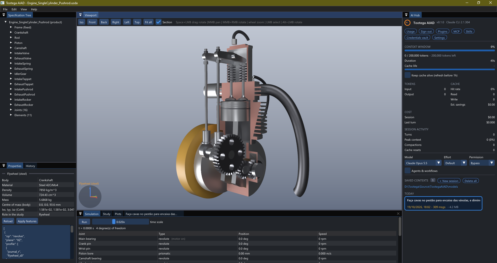
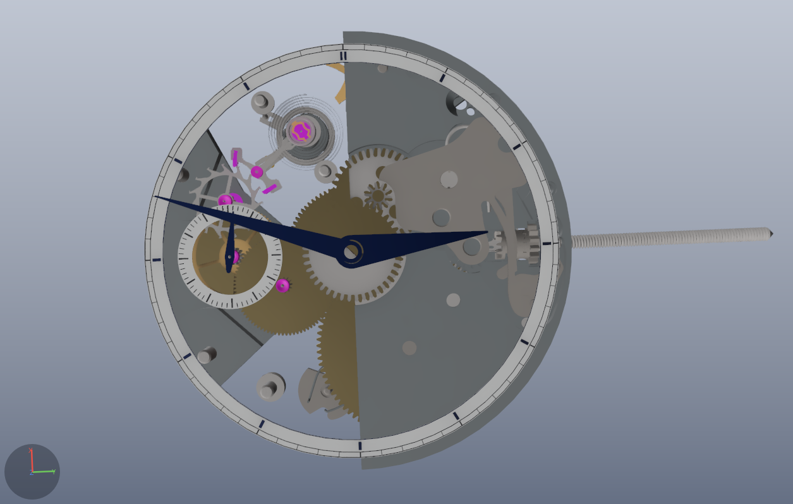
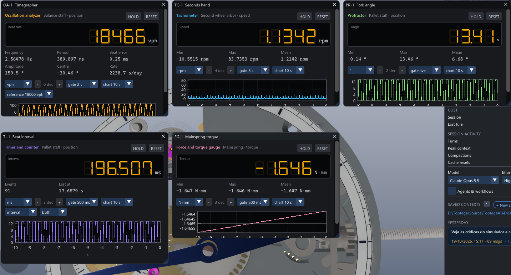
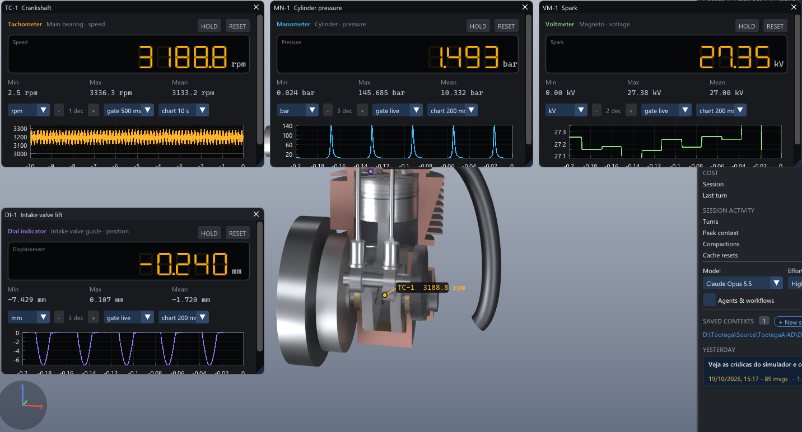

# Tootega AIAD — Artificial Intelligence-Aided Design

A 3D CAD/CAE tool for **Windows** where the user **and an AI** operate the same exact model: B-rep NURBS
geometry (USD BRep / SMLib) in an **OpenUSD** document, **MaterialX** materials, a **Hydra** viewport
with **DirectX 12 (DXR)** path tracing, and simulation on **CUDA** (MFEM, Project Chrono). Every change
to the model goes through the same **Command Bus**, with undo, validation and an audit trail, whether it
comes from the UI, a script or the AI (through MCP).



## Project stage

**Current milestone: a four-stroke internal combustion engine designed in the tool and running in its
simulator.** Steps M1.1 to M1.6d and the generic simulator (G-A to G-D) are done (see
[Docs/03-plano-execucao.md](Docs/03-plano-execucao.md)). The infrastructure spikes S1 to S8 are closed.
S6 (electromagnetics with Palace) compiles and runs; it is off the milestone's path.

**The simulator is generic.** No machine is known to the code. A machine is a drawing plus:

- bodies;
- joints;
- elements: gears, belts, racks, cam/pad contacts, springs, loads, gas chambers, magnetos.

Every physical input is measured on the drawn parts. The simulator criticises the drawing, and it refuses
to run what would not work, saying how to fix it. Both example engines run on their own, built only from
their documents:

- an OHC engine with a timing belt: about 3000 rpm, 8.6 kW;
- an OHV engine with a gear train, pushrods and rockers (compression ratio 20 in the current drawing):
  about 3160 rpm, 10.7 kW.

| Done | Open |
|------|------|
| Parametric OpenUSD document: design parameters + formulas, materials, rigid bodies, B-rep parts with feature history, joints (UsdPhysics) and machine elements | edges/silhouettes in the viewport |
| Generic machine simulation: Chrono mechanism + gear/belt/rack couplings, cam and rocker contacts, coil and spiral springs, outlines that touch (escapements), stops, loads, timed motors; oscillations reported (amplitude, frequency, beats per hour) | hollow pipes (exhaust/intake) |
| Watch scale: an imported ETA 6497 movement (STEP) ticks: escapement, balance at about 18,470 vph (rated 18,000) and about 158° of amplitude, the train turning; its regulator is set by hand and changes the rate (±2.3 min/day); its hands can start at the computer's local time | the keyless works (winding stem: pull out and turn the crown) are not drawn as a mechanism yet; the watch gains about 37 min/day with the regulator centred, and the drawn train turns the seconds hand at about 1.2 rpm instead of 1 rpm |
| Measuring instruments with ideal probes (they read the solver and change nothing): tachometer, timegrapher (vph, beat error, amplitude, rate), manometer, thermometer, protractor, dial indicator, force/torque gauge, voltmeter, accelerometer, timer/counter, universal meter, chart recorder, dynamometer readout; seven-segment panels with statistics, unit, decimals, gate and chart, readable in slow motion, detachable to another monitor; marks in the view; read by the agent | probes on a point of a body (today: joints and elements) |
| Parts set by hand (adjusters): recognised from the drawing (a joint with a range that nothing drives), held while the machine runs, moved with a lever or slider on the part | hand-driven inputs while running (a crown, a crank) |
| Domain elements tied to the drawing: 0D Otto cycle chamber (bore, chamber volume and valves measured on the parts), 2D magneto (MFEM on the drawn magnet and core) → spark; a dynamometer (bench brake) on any shaft for the real brake power, torque and power curve | valve–piston clash check; bevel/crossed gears |
| The simulator's critique with a fix for every problem; everything it measured is listed | turbine and flow studies as document entities (next) |
| Hydra/Aurora viewport with path tracing, selection, highlight, section planes (any number, any orientation, per part, dragged in the view), 6-DOF animation of any body; per-object motion vectors, so the denoiser keeps moving parts sharp | live cost estimate during a turn |
| A UI that never waits: the live simulation on its own thread, the view updated in slices, agent commands computed off the UI thread, the magneto field table on every core | simulation speed: one step depends on the last, so a machine runs on one core (real time is reached: about 1.75x for the OHC engine, 1.0x for the OHV one on this 22-core desktop) |
| AI layer at Cockpit level: hub, tabbed sessions, permissions, questions, plans, usage/cost | |
| MCP server (`aiad-mcp.exe`) with the catalogue generated from the Command Bus + a skill for the agent | |

## A watch that ticks



The hardest test of the simulator is not the engine: it is a hand-wound **ETA 6497** pocket-watch movement
imported from STEP (101 parts, no sketches, no feature history). The document only adds what a watchmaker
knows: which parts form a body, where the arbors are (joints), which wheels mesh, which spirals are the
mainspring and the hairspring, and which outlines touch. Everything else is measured on the imported solids.
It now ticks: the mainspring drives the train, the escape wheel pushes the pallet fork, the fork kicks the
balance, the balance swings on its hairspring and lets the train advance one tooth per beat. The hands start
at the computer's local time.

What it took to make it run right:

| Problem | What was done |
|---------|---------------|
| **Scale.** A balance wheel's inertia is about 1e-11 kg m², a beat lasts 0.2 s, the impulse lasts a few ms. Fixed floors and stiffnesses tuned for an engine either froze the watch or made it explode | nothing in the mechanism has an absolute floor near those values: inertia floors, effective masses and coupling shafts are relative, and the contact stiffness of every touch comes from the masses it joins (a fixed contact frequency), never a fixed N/m |
| **The escapement is geometry.** The escape wheel's teeth, the pallet stones, the impulse pin, the fork horns and the guard pin interact only through their shapes | `touch`: the outlines of two parts are cut from their solids at the height they share (fine tessellation, no sketch needed) and collide in the plane of their arbors |
| **Springs come from the drawing.** The rate depends on the hairspring's strip, the power on the mainspring's | `torsion` measures the strip (thickness, height, active length) on the section of the drawn or imported spiral and takes its elastic modulus from the material; the regulator's index pins (`holder`) shorten the working length |
| **The kernel fought back.** SMLib's mass integration changed the brep it measured (a hairspring's section lost 7 points in 8); rebuilding the trim curves of imported spline faces cost about 10 s per toothed wheel; booleans on flush faces read out of bounds | mass is integrated on a copy; mass and bounds are saved with each part (keyed by a fingerprint of its solid), fixed bodies need none; the boolean catches the fault and reports it |
| **Load and size.** 70 s to open, 27 MB of text | the design in text (`.usda`, 0.16 MB) and the exact geometry in binary (`.geom.usdc`, 8.6 MB, OpenUSD payload); it opens in about 16 s with a progress bar and ETA |
| **Speed.** A watch needs steps of tens of µs for seconds of motion | the live run reaches about 0.8–0.9x real time on one core, with the UI never waiting |
| **Setting it.** A real watch is regulated by hand | the regulator is recognised as an adjuster (a joint with a range that nothing drives): a lever on the part moves it, and the rate follows (±0.15 rad ≈ ±2.3 min/day) |

The instruments below say where it still differs from the real movement: the balance beats at about
18,470 vph with about 158° of amplitude and a beat error of 0.25 ms (the 6497 is rated 18,000 vph: with the
regulator centred it gains about 37 min/day, so the hairspring or the index pins are not yet as drawn by ETA),
and the seconds hand averages about 1.2 rpm instead of 1 rpm (the drawn train does not have the 6497's ratios
yet). The keyless works (pull the crown out and turn it) are not a mechanism yet.

## Measuring instruments



Instruments are document entities (`/Root/Instruments`) plugged into the machine with ideal probes: they
read the solver at every step and change nothing. Right-click a part in the view (or in the tree): the menu
lists the joints that move it and the elements that use it, each with the instruments that can read it.
A seconds hand: its arbor, then the tachometer. View > Instruments shows and hides them; the agent plugs and
reads them through MCP (`aiad_instrument_define`, `aiad_instrument_read`).

| Instrument | Reads |
|------------|-------|
| TC-1 tachometer | speed of a joint (rpm, rad/s, Hz...) |
| OA-1 oscillation analyzer (timegrapher) | beat rate (vph), period, beat error, amplitude, centre and rate in s/day against a reference |
| MN-1 manometer, TH-1 thermometer | chamber pressure and gas temperature |
| DY-1 dynamometer | on a `dynamometer` element: brake power (kW, W, hp, cv), torque, speed, held speed, the indicated power of the chambers turning that shaft and the mechanical efficiency, the peak power and torque with their rpm, and the torque and power curve against rpm (only the points where the brake held the speed) |
| PR-1 protractor, DI-1 dial indicator | angle or displacement of a joint |
| FG-1 force and torque gauge | contact, spring and touch forces, spiral torques |
| VM-1 voltmeter | magneto primary and spark voltage |
| AC-1 accelerometer | joint acceleration |
| TI-1 timer and counter | interval, frequency, count or stopwatch between crossings (rise, fall, both), interpolated between steps |
| MM-1 universal meter, CR-1 chart recorder | any channel, any dimension |

Each panel is a bench instrument: a seven-segment main reading, secondary readouts (min, max, mean, and
what the type adds), HOLD and RESET, unit, number of decimals, gate (live or averaged over 0.1 s to 10 s) and
a chart of the last 0.5 s to 2 min (any window through the command; min/max band and mean). In the view, each probe is marked with the
instrument's colour and its reading. A panel dragged out of the main window becomes a window of its own (another
monitor: an instrument bench); where it is and its size are saved with the layout.

**Slow motion.** Gate and chart are what the user watches, in wall time: at 0.002x a 500 ms gate averages 1 ms of
the machine and a 10 s chart shows its last 20 ms, so a reading follows each moment of a cycle (the panel says
how much machine time they cover). At full speed one moment cannot be read, so a chamber's manometer and
thermometer also show the gas at the events of its last cycle: when the intake closes, at ignition, the
combustion peak (and how many degrees after top dead centre), when the exhaust opens.



On the OHV engine: about 3,190 rpm, 145.7 bar peak pressure, a 27 kV spark at every cycle and 7.4 mm of
intake valve lift.

## What it does and how

### Application (`aiad.exe`)

It opens with no document.

- **Menus:** **File** has New (Ctrl+N), Open… (Ctrl+O), Open Recent, Save (Ctrl+S), Save As…
  (Ctrl+Shift+S), Close and Exit, and asks before discarding unsaved changes. **Edit** undoes and redoes;
  **View** fits the model, toggles the section, opens the section planes and restores the layout.
- **Opening a document:** the machine of the drawing is derived and checked.
- **Example engines:** `models\Engine_SingleCylinder.usda` (OHC) and
  `models\Engine_SingleCylinder_Pushrod.usda` (OHV), next to the executable.
- **Saved layout:** panel layout, window placement and where the AI chat opens are kept in
  `<exe folder>\.aiad\aiadconfig.json` (`build-dist.ps1` keeps it, and the agent's sessions in
  `models\.aiad`, when it rebuilds `Dist\`).
- **Saved view:** the camera (orientation, centre, zoom) is saved with the document and found again when it
  is opened.
- **Loading:** a bar shows the parts being displayed with the time left, then the machine being measured.
  An imported movement (the ETA 6497, 101 parts) opens in about 16 s.
- **Closing:** it never hangs; if the shutdown takes more than 5 s, `aiad_hang.dmp` (every thread's stack) is
  written next to the executable and the process ends.
- **AI:** it works in the folder of the open document.

| Window | What it does |
|--------|--------------|
| **Viewport** | path-traced model. Click selects a part; **right click** on a part: what can be measured on it (the joints that move it, the elements that use it) and the instruments that read it; **left drag** (or the middle button) pans; **Alt + left**, **Space + left** or middle + right rotates; the wheel zooms on the point under the cursor, from 0.1 mm to 50 m. **Section planes** (toolbar **Planes...**, or right click on a part: "Cut only this part"): as many as needed, any orientation, each cutting every part, only some parts or bodies, or all but some; drag the tip of a plane's arrow to turn it in 3D and its centre to move it in depth (the cut follows live, one undo step when let go); the Sections panel sets the same by axis, facing the view, turn, tilt and offset. Display only: the solids are never cut. A selected part that is set by hand shows its control on it: a lever (it turns) or a slider (it slides) |
| **Specification Tree** / **Properties** | bodies and parts, joints, elements; material, mass, volume, features and parameters of the selected part; **Set by hand** for an adjuster |
| **Study** | the simulator's findings (each with its fix), or the machine summary and what was measured on the drawing; design parameters (values or formulas) |
| **Simulation** | runs the machine live at the chosen time scale (shows the speed reached when the computer cannot keep up): every joint (position and speed), chambers (pressure, volume, combustions), magnetos |
| **Instruments** (one panel each) | plugged with a right click on a part in the view or in the tree, or on a joint or element in the tree; a seven-segment display with the main reading, secondary readouts (min/max/mean, beat error, amplitude...), HOLD, RESET, unit, decimals, gate (averaging), chart window and the chart; a chamber's gas at the events of its last cycle; can be dragged out to another monitor; View > Instruments shows and hides them |
| **Plots** | any channel (joint speed or position, chamber pressure and volume, spark voltage, contact and spring forces) against time or a joint's angle; p-V loops |
| **History** | Command Bus history; **Ctrl+Z / Ctrl+Y** undo and redo any command, the AI's included |
| **AI Hub** | Claude Code sessions, usage and limits, MCP servers, skills, plugins, credential vault, settings; **+ New session** opens a chat tab |
| **Chat** (one tab per session) | prompt with a queue (**Send** while the previous turn runs, **Stop** next to it), Markdown, permissions (**Ctrl+Enter** allows, **Esc** denies), questions, plans, live statistics |

Command line:

```text
aiad.exe                             UI, no document open
aiad.exe <document.usda>             opens the document
aiad.exe --run <doc.usda>            opens it and starts the machine
aiad.exe --check <doc.usda>          the simulator's critique of the drawing, no window (exit 0 = it can run)
aiad.exe --simulate <doc.usda> <s>   runs the drawing's machine for s seconds and prints what it measured
aiad.exe --snapshot <png> [doc]      no window: builds, animates 60 frames, toggles section/highlight, writes PNGs
aiad.exe --ui-test <png>             real window: MCP -> bridge -> Command Bus, simulation, chat, capture
```

### Responsiveness and threads

- **The UI thread only draws and edits.** The document caches what is derived from each part's solid
  (display mesh, mass, bounds), keyed by its revision, so a change re-derives only the parts it touched.
  The view rewrites changed parts in slices of about 10 ms per frame. The machine study is rebuilt once the
  view has caught up.
- **The live simulation runs on its own thread** at the requested time scale. When the computer cannot keep
  up, it runs as fast as one core allows, and the UI keeps drawing.
- **Agent commands:** the agent's requests wait (on the bridge's thread) until the view has caught up.
  Pure computation, such as a simulation run, completes off the UI thread.
- **The magneto field table** (91 MFEM solves) uses every core: about 17 s instead of about 70 s, and it is
  cached.
- **Kernel calls stay on the UI thread.** The geometry kernel (SMLib) is not thread-safe. A change that
  regenerates many parts still costs about half a second. SMLib rebuilds the trim curves of imported spline
  faces on every exact mass integration (about 10 s for a toothed wheel), so the mass and bounds of each part
  are saved with it (`aiad:derived`, keyed by a fingerprint of its solid), and fixed bodies need no mass.
- **Kernel failures do not take the app down.** SMLib can read out of bounds when two solids touch exactly
  along faces (marks flush with a ring); the boolean catches it and the command fails with the cause and the
  fix (overlap the solids, or keep them apart). Features finer than about 0.15 mm also fail in SMLib.
- **The mechanism solver:** sparse LU on a regularized system, so redundant constraints are allowed (a
  planar linkage made of spatial joints). Eigen chooses the ordering and the pivots; the next steps
  refactor numerically with the same pivots (as KLU does), until a pivot gets small. The system matrix is
  written straight into its slots, and joints are Chrono mate joints with a leaner Jacobian update.
- **Where a step goes** (sampling profile, OHV engine, about 20 µs per 20 µs step): LU refactor and solve
  36%, Chrono's per-step bookkeeping 29%, joint updates 20%, contacts/springs/stops 6%, gas 5%. Before
  this work, Eigen's supernodal LU took 64% of a 113 µs step, mostly symbolic work redone every step.

### A machine is a drawing

Everything in the viewport is a part of the document, created by commands; there is no geometry in code.

| In the document | What the simulator takes from the drawing |
|-----------------|-------------------------------------------|
| Bodies (one may be fixed: the ground) | mass, centre of mass and inertia tensor from the parts × material density |
| Joints (`revolute`, `prismatic`, `cylindrical`, `spherical`, `planar`, `fixed`), with motors and stops | point and axis as formulas over the parameters; `start`: where it starts, a value or `{"local_time": period}` from the computer's date and time when the run starts (a watch's hands: 60, 3600, 43200 s); gears take the positions as they start |
| Adjusters: a joint with a range (`limits`) that nothing drives | set by hand (`aiad_adjust`, or the lever/slider on the part), held there while the machine runs: a regulator, an idle screw, a lever |
| `gear`, `belt`, `rack` | teeth and pitch radii of the drawn wheels (sketch tools `gear`, `sprocket`) |
| `contact` | the drawn profile (cam lobe, rocker pad) on a follower's flat face |
| `spring` | wire, coil, turns and shear modulus of the drawn coil |
| `torsion` | the strip of a drawn spiral (hairspring, mainspring: sketch tool `spiral` or imported), measured on its section, and its elastic modulus; a `holder` (a regulator's index pins) leaves only the strip up to it working, from where the holder is set |
| `touch` | the outlines of two parts cut from their solids (drawn or imported) where they share a height: escape wheel and pallets, impulse pin and fork, guard pin and roller |
| `load` | friction, brake or propeller torque on a joint |
| `dynamometer` | a bench brake on a shaft (any revolute joint: a crankshaft, a turbine's rotor) that measures the real (brake) power: holds a speed and reads the torque it absorbs there, sweeps the speed for the torque and power curve, or brakes with a constant torque; it only absorbs, its controller's gains come from the shaft's inertia measured on the drawing |
| `chamber` | bore, chamber volume and valve sizes measured on the parts |
| `magneto` | magnet, pole shoes and core geometry; the field is computed with MFEM |

The example engines are command scripts:

```powershell
Dist\aiad-model.exe build models\Engine_SingleCylinder.aiad.json models\Engine_SingleCylinder.usda
Dist\aiad-model.exe apply models\Clock.usda models\Clock_regulator.aiad.json models\Clock_reg.usda   # a script on a document
Dist\aiad-model.exe info  models\Engine_SingleCylinder.usda     # parts, masses and centres, regeneration errors
Dist\aiad-model.exe outline models\Clock.usda 0.0004 "721 Balance [2]"   # a part's section, as the simulator cuts it
Dist\aiad.exe --simulate models\Engine_SingleCylinder.usda 3     # runs it 3 s and reports
```

A document on disk follows OpenUSD's interface + payload pattern: `<name>.usda` is the design in text
(parts and features, bodies, joints, elements, parameters, the saved view), and `<name>.geom.usdc` holds the
exact geometry (B-rep) in binary, brought in by a payload. The ETA 6497 movement takes 0.16 MB + 8.6 MB instead
of 27 MB of text. Older single-file documents open as they are and are split on the next save.

### AI and MCP

- The agent (Claude Code CLI, `stream-json`) runs with the **open model's folder** as its working
  directory. It finds the skill [`models/.claude/skills/aiad-mcp/SKILL.md`](models/.claude/skills/aiad-mcp/SKILL.md)
  there.
- `aiad-mcp.exe` is a stdio MCP server. It talks to the running application over the loopback bridge
  `aiad-bridge/1` (one token per instance).
- The tools are the Command Bus commands:
  - parameters, materials, parts and features, bodies;
  - joints, elements;
  - the simulator's critique (`aiad_mechanism_check`), runs (`aiad_mechanism_run`, background jobs with
    `aiad_sim_run`);
  - adjusters (`aiad_adjust`);
  - measuring instruments (`aiad_instrument_define`, `aiad_instrument_read`...);
  - visibility, selection, camera, viewport snapshot;
  - save, undo/redo.
- The AI is just another operator: everything it does shows up in the history, goes through permissions
  and can be undone. When the simulator refuses a drawing, the agent fixes the drawing, not the app.

## Requirements

| Item | Version |
|------|---------|
| System | Windows 10/11 x64 |
| GPU | NVIDIA with DXR (RTX), recent driver; CUDA and D3D12 on the same adapter |
| Visual Studio | **2026 (18) Community**, "Desktop development with C++" workload, toolset **v145** (MSVC 14.51), Windows SDK 10.0.26100. Its CMake is only used to rebuild dependencies |
| CUDA Toolkit | **13.3** in the default path (`C:\Program Files\NVIDIA GPU Computing Toolkit\CUDA\v13.3`) |
| Tools | Git, PowerShell 7, **Python 3** with the `py` launcher (python.org installer; it packs Aurora's shaders during the build), 7-Zip (optional; without it Windows' `tar` extracts the packages) |
| AI (optional) | [Claude Code CLI](https://claude.com/claude-code) on `PATH`, logged in |

## Build and run

```powershell
git clone --recurse-submodules https://github.com/HermesSilva/TootegaAIAD.git
cd TootegaAIAD
pwsh -File deps\fetch-prebuilt.ps1     # prebuilt dependencies (~0.5 GB), checked by SHA-256
start TootegaAIAD.slnx                 # Visual Studio: Build, and F5 runs aiad (below)
pwsh -File build-dist.ps1              # or: builds, runs the tests, assembles Dist\ and runs the app tests
Dist\aiad.exe Dist\models\Engine_SingleCylinder.usda   # or File > Open
```

`build-dist.ps1` runs nine timed steps and stops at the first error:

1. It checks that `TootegaAIAD.slnx` loads in Visual Studio (`devenv`).
2. It builds the solution with MSBuild: `aiad.exe`, `aiad-mcp.exe`, `aiad-model.exe` and the tests.
3. It runs the unit tests: `kernel`, `document`, `multibody`, `command_bus`, `agent_session`,
   `mcp_bridge`, `claude_cli`. The last one is skipped without the CLI.
4. It assembles `Dist\`, checking with `dumpbin` that only the allowed DLLs are imported.
5. It runs `--snapshot` and `--ui-test`. `-SkipSnapshot` skips these two.

`Dist\` is self-contained and can be copied to another machine with an NVIDIA GPU. The first run of a
magneto geometry computes its field table (about 70 s); it is then cached next to the executable.

### Visual Studio 2026

The solution **`TootegaAIAD.slnx`** is at the root. Each project has its **versioned `.vcxproj` next to
its code** (`src\aiad_app\aiad.vcxproj`, `src\aiad_doc\aiad_doc.vcxproj`...). After the checkout and
`fetch-prebuilt.ps1`, open the solution and build. The app has no CMake.

| What | Where |
|------|-------|
| Paths (`AiadRoot`, `AiadDeps`, `AiadCuda`, `AiadPython`) | `Directory.Build.props` (root; MSBuild imports it by itself) |
| Common settings (v145, C++20, `/MD`, AVX2, outputs) | `src\Aiad.props` |
| Outputs | `_build\<Configuration>\bin` (executables), `lib`, `obj` |
| Runtime for running/debugging from VS | copied to `_build\<Configuration>\bin` by the build (`src\aiad_app\AiadRuntime.targets`, `Aurora4AIAD.Runtime.targets`) |

Solution folders:

- **Root:** the AIAD projects. `aiad` is the startup project: F5 runs (or debugs) it from
  `_build\<Configuration>\bin`.
- **Tests:** the unit tests.
- **ThirdParty:** the dependency forks changed for AIAD.
  - `Aurora` (Foundation, Aurora, HdAurora): `.vcxproj` in the fork, built with the app.
  - `libCEED`: `.vcxproj` in the fork.
  - `Palace`: `deps\vs\palace.vcxproj`, which runs the superbuild.

  `libCEED` and `Palace` are left out of the solution build; build them from the menu.

Configurations: **Release** (optimised) and **Debug** (no optimisation, with `assert`). Both use the release
CRT (`/MD`), because all prebuilt dependencies are release builds.

## Dependencies

Policy: everything we build or vendor is **linked statically** into one `aiad.exe`. The only DLLs allowed
are:

- the system's (D3D12, DXGI, Win32) and the NVIDIA driver;
- the shader compilers (`dxcompiler`/`dxil`, Slang);
- cuSPARSE/cuBLAS (NVIDIA ships no static versions);
- the MSVC runtime (`/MD`);
- MS-MPI, only in the solvers.

| Dependency | Version | License | How it comes |
|------------|---------|---------|--------------|
| OpenUSD (+ oneTBB 2021.13, OpenSubdiv 3.6.1) | 25.11 (`363a7c8d`), static, no Python | TOST 1.0 / Apache-2.0 | prebuilt |
| NVIDIA USD BRep (SMLib, `omniSolid`, `hdUsdBrep`) | 1.0.0 (`c9c5979f`), static | Apache-2.0 | prebuilt |
| Autodesk Aurora + HdAurora | fork [aurora-4AIAD](https://github.com/HermesSilva/aurora-4AIAD) | Apache-2.0 | submodule, built with the app |
| Aurora externals (MaterialX 1.39.5 with Slang, Slang, DXC, NRD/NRI, Boost…) | see `deps/_externals/aurora/*.version.txt` | various | prebuilt |
| MFEM + CUDA | 4.10, fp64 | BSD-3 | prebuilt |
| Project Chrono (`Chrono_core`) | 10.0.0, static | BSD-3 | prebuilt |
| Eigen | 3.4.1 | MPL-2.0 | submodule |
| Dear ImGui (docking) / ImPlot | v1.92.9-docking / v1.0 | MIT | submodules |
| nlohmann/json | 3.12.0 | MIT | in the repository (`deps/_src/nlohmann_json`) |
| DSEG7 Classic (seven-segment font of the instruments; keshikan, from RTR-Bench) | as in RTR-Bench | SIL OFL 1.1 | in the repository (`src/aiad_app/fonts`), embedded in `aiad.exe` |
| libCEED | fork [libceed-4AIAD](https://github.com/HermesSilva/libceed-4AIAD) | BSD-2 | submodule (ThirdParty) |
| Palace | fork [palace-4AIAD](https://github.com/HermesSilva/palace-4AIAD) | Apache-2.0 | submodule (ThirdParty; needs the MS-MPI SDK and LLVM `flang`) |

The prebuilt packages are in the [`deps-2026.10.19`](https://github.com/HermesSilva/TootegaAIAD/releases) release,
listed with SHA-256 in [`deps/prebuilt.json`](deps/prebuilt.json). `fetch-prebuilt.ps1` also rewrites the
absolute paths recorded in the packages' configuration files to the clone's folder.

To **rebuild the dependencies from source**, use the scripts in [`deps/_src`](deps/_src) and
[`deps/_externals/aurora`](deps/_externals/aurora) with the patches in [`deps/patches`](deps/patches).
[deps/README.md](deps/README.md) gives the order, the versions and the pitfalls. The maintainer publishes
new packages with `pwsh -File deps\pack-prebuilt.ps1 -Publish`.

## Layout

| Folder | Contents |
|--------|----------|
| `src/aiad_core` | JSON, text, paths, main-thread queue |
| `src/aiad_cmd` | Command Bus: registry, JSON Schema validation, undo/redo, audit |
| `src/aiad_bridge`, `src/aiad_mcp` | loopback bridge `aiad-bridge/1` and MCP server `aiad-mcp.exe` |
| `src/aiad_ai` | Claude Code CLI process, `stream-json` session, transcripts, account and usage |
| `src/aiad_kernel` | USD BRep/SMLib facade (the only module that includes it; C++17) |
| `src/aiad_doc` | parametric OpenUSD document (parts, bodies, joints, elements), expressions, features, document commands, `aiad-model` |
| `src/aiad_sim` | generic mechanism (Chrono: couplings, contacts, springs, stops), machine (mechanism + chambers + magnetos), 0D Otto cycle, magneto (MFEM) |
| `src/aiad_render` | Hydra + HdAurora viewport |
| `src/aiad_app` | ImGui application: scene, machine study and critique, session, app commands, AI panels |
| `models/` | documents (`*.usda`) and command scripts (`*.aiad.json`); the agent's skill |
| `deps/` | scripts, patches, prebuilt manifest and submodules |
| `spikes/` | spikes S2–S8 (validation code for each technology) |
| `Docs/` | survey, architecture, execution plan, diagrams (in Portuguese) |

## Documents

| Document | Contents |
|----------|----------|
| [Docs/01-levantamento.md](Docs/01-levantamento.md) | internal references (Cockpit, DASE50), technologies, environment, risks |
| [Docs/02-arquitetura.md](Docs/02-arquitetura.md) | principles, decisions, modules, contracts (Command Bus, AI, Bridge, GPU, simulation, render) |
| [Docs/03-plano-execucao.md](Docs/03-plano-execucao.md) | phases, spikes, acceptance criteria, results log |
| [CLAUDE.md](CLAUDE.md) | project rules for agents (and people) |

| Diagram | What it shows |
|---------|---------------|
| [arquitetura-blocos.svg](Docs/diagrams/arquitetura-blocos.svg) | system blocks and protocols between processes |
| [dependencias.svg](Docs/diagrams/dependencias.svg) | projects, build and runtime dependencies, third parties and licenses |
| [fluxo-ia.svg](Docs/diagrams/fluxo-ia.svg) | sequence of a request to the AI, from the prompt to the verification snapshot |

## License

Open source. The project's license follows what the dependencies require; the current recommendation is
**Apache-2.0** (the maintainer's decision is pending). Maintainer: Tootega Pesquisa e Inovação
([HermesSilva](https://github.com/HermesSilva)).
